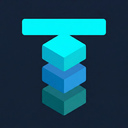
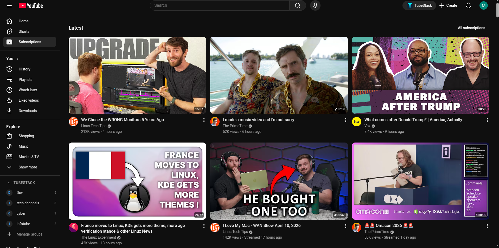
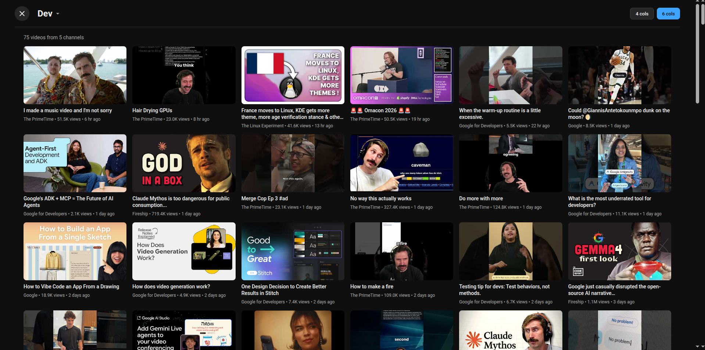
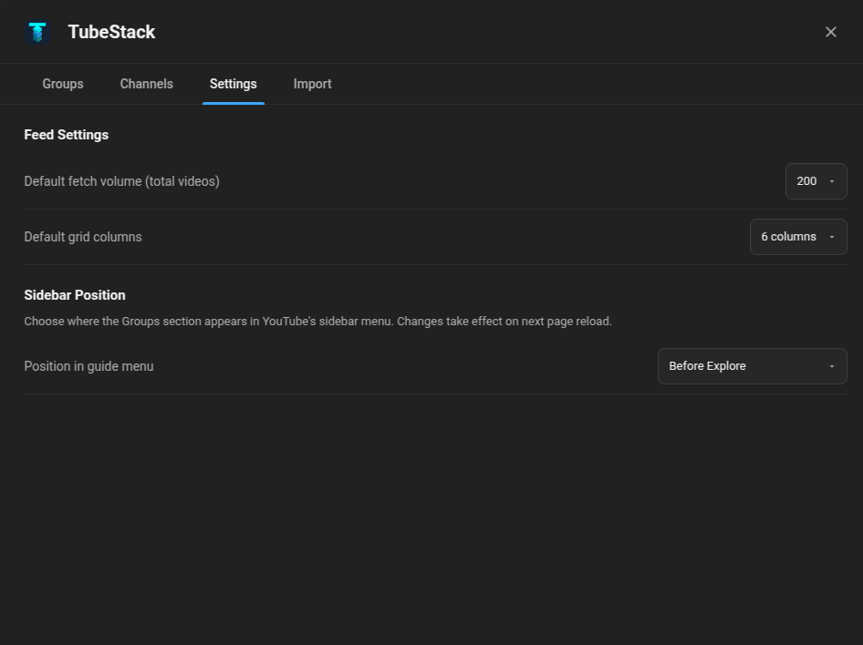
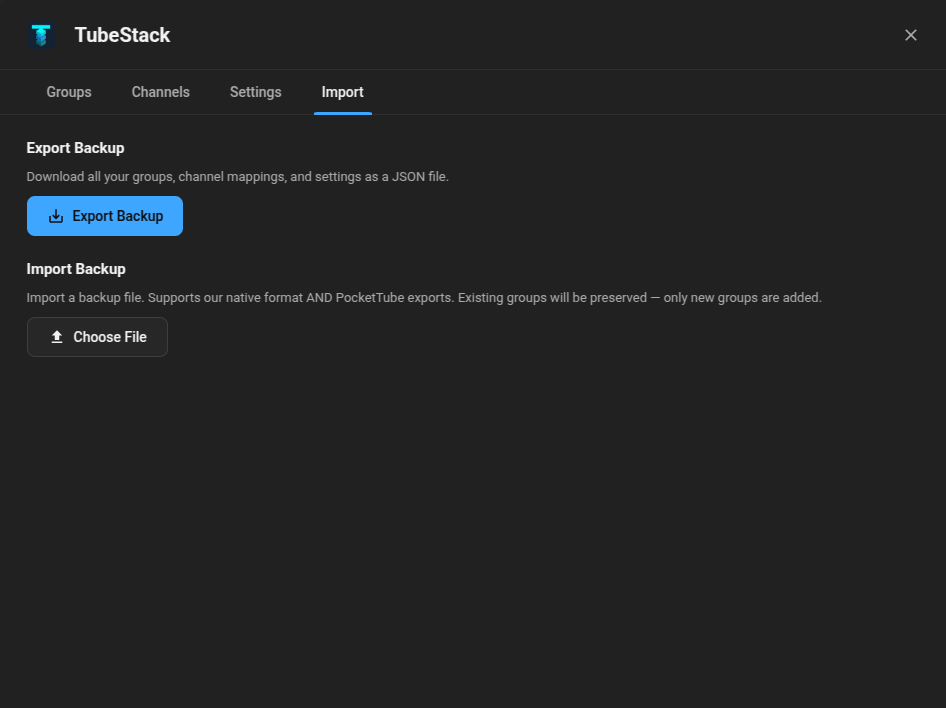
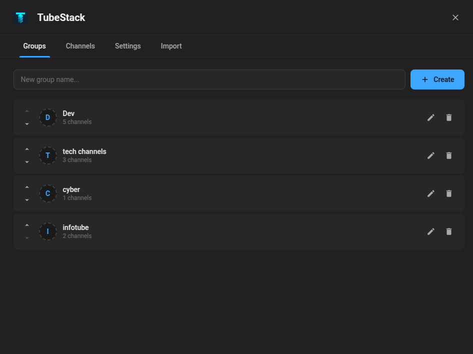
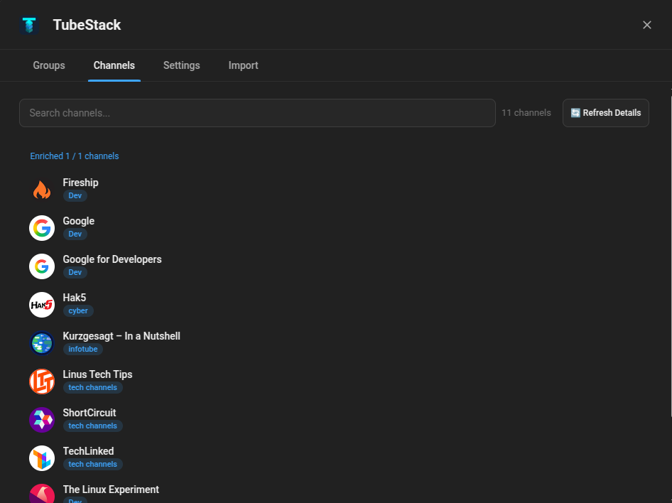

<div align="center">
  
  <h1>TubeStack</h1>
</div>

## Features

TubeStack transforms your YouTube experience by allowing you to organize your subscriptions into manageable, custom groups.

### 1. Seamless YouTube Sidebar Integration
TubeStack is beautifully integrated right into your YouTube sidebar. You can easily view and access your customized subscription groups natively without interrupting your flow.

<p align="center">
  
</p>

### 2. Dedicated Group Feeds
Clicking on a group instantly brings up a dedicated feed containing all the latest videos specifically from the channels within that group.

<p align="center">
  
</p>

### 3. Customizable Settings Dashboard
Take full control over the extension's behavior through the comprehensive and intuitive settings dashboard. Customize aspects such as:
- **Sidebar Position:** Choose exactly where the TubeStack groups appear within the YouTube sidebar menu.
- **Feed Customization:** Adjust the number of videos loaded per feed to fit your viewing preferences.

<p align="center">
  
</p>

### 4. Import & Export Flexibility
Easily backup your categorized groups and channels, or import your backups across different devices to sync your personalized setup.

<p align="center">
  
</p>

### 5. Advanced Group Management
Create, edit, and organize multiple groups directly from the dashboard to curate your viewing habits exactly how you want.

<p align="center">
  
</p>

### 6. Channel Organization
Assign specific YouTube channels to your distinct groups with a few simple clicks inside the dashboard interface.

<p align="center">
  
</p>

## Setup and Installation

TubeStack is cross-browser: the same source builds both a Chromium extension (Chrome, Edge, Brave) and a Firefox extension.

### Option 1: Quick Install (Loading the ZIP)

**Chrome / Edge / Brave**

1. Download the `tubestack-vX.Y.Z.zip` file from the repository releases.
2. Extract the contents of the ZIP file to a folder on your computer.
3. Open your browser and navigate to the extensions page (`chrome://extensions/`).
4. Enable **Developer mode** (usually found in the top right corner).
5. Click **Load unpacked** and select the extracted folder.
6. TubeStack is now installed and ready to be set up!

**Firefox**

1. Download the `tubestack-firefox-vX.Y.Z.zip` file from the repository releases and extract it.
2. Open `about:debugging#/runtime/this-firefox` in Firefox.
3. Click **Load Temporary Add-on…** and select the extracted `manifest.json`.

   *Temporary add-ons are removed when Firefox closes. For a permanent install, submit the ZIP to [addons.mozilla.org](https://addons.mozilla.org/) or use a [self-distributed signed build](https://extensionworkshop.com/documentation/publish/self-distribution/).*

> **Note:** In Firefox, this MV3 extension uses host permissions for `youtube.com`. When installed from a signed build, Firefox prompts you to grant them; content-script features only work once granted.

### Option 2: Clean Install from Source 

If you wish to build the extension yourself from its source files, ensure you have [Node.js](https://nodejs.org/) and `npm` installed.

1. Clone or download this project's source code to your local machine.
2. Open a terminal and navigate to the root directory of the project:
   ```bash
   cd TubeStack
   ```
3. Install the necessary build dependencies using npm:
   ```bash
   npm install
   ```
4. Build the application for your browser:

   **Chrome / Edge / Brave**
   ```bash
   npm run build
   ```
   *This generates a compiled `dist` directory. The `manifest.json` lives at the project root and references `dist/`.*

   **Firefox**
   ```bash
   npm run build:firefox
   ```
   *This generates a self-contained `dist-firefox` directory (including its own `manifest.json`).*

5. Open your browser and navigate to the extensions page.

   **Chrome / Edge / Brave:** go to `chrome://extensions/`, enable **Developer mode**, click **Load unpacked**, and select the project root folder (which contains `manifest.json`).

   **Firefox:** go to `about:debugging#/runtime/this-firefox`, click **Load Temporary Add-on…**, and select `dist-firefox/manifest.json`.
